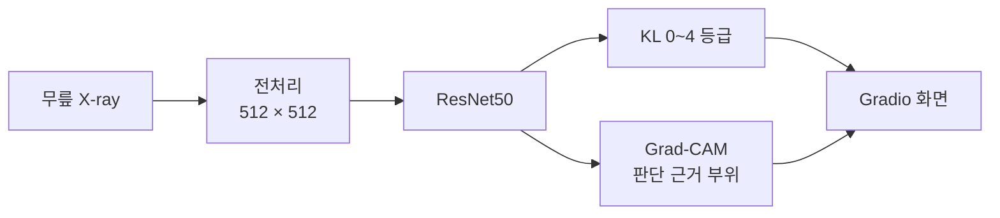

# 🦵 Knee OA Classifier

무릎 X-ray로 퇴행성 관절염 단계(Kellgren–Lawrence 0~4등급)를 분류하고, 모델이 어느 부위를 보고 판단했는지 Grad-CAM으로 보여 주는 5인 팀 프로젝트입니다.

> 결과 (테스트 3,052장): **Accuracy 0.722 · Macro-F1 0.735 · QWK 0.847**
>
> 내 역할: 저장소 구조 설계, Git 협업 규칙 운영, ResNet50 구현

## 🔄 동작 흐름

X-ray를 전처리해 ResNet50에 넣으면 KL 0~4 등급과 Grad-CAM 히트맵이 나오고, Gradio 화면에서 이미지를 올려 바로 확인할 수 있습니다.

## 📂 문서

| 문서 | 내용 |
|---|---|
| [결과](docs/results.md) | 등급별 F1과 분석, Grad-CAM 예시, 학습 설정, 한계 |
| [실행 방법](docs/setup.md) | 설치 · 데모 실행 · 한 장 예측, 폴더 구조, 데이터 출처 |
| [팀 구성](docs/team.md) | 팀원별 역할, 협업 규칙 |
| [평가 보고서](outputs/evaluation/fine_tune_report.txt) | 테스트 세트 평가 원본 |

코드: MIT License. 데이터: CC BY 4.0, 원저작자 Pingjun Chen ([데이터 출처](docs/setup.md)).
