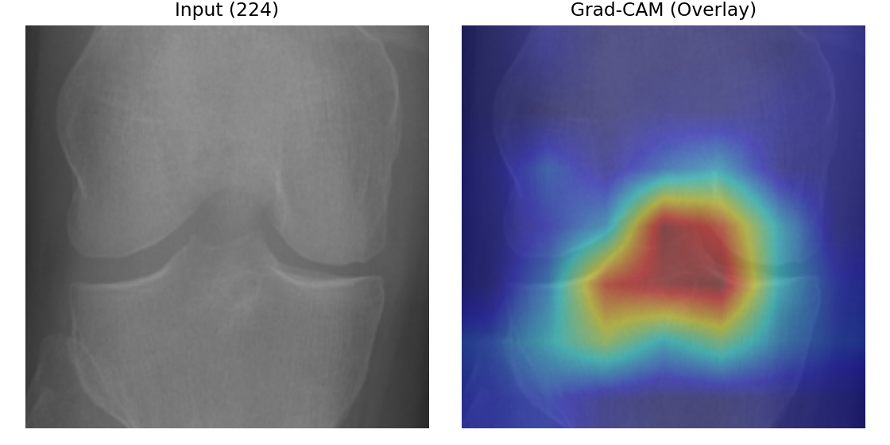
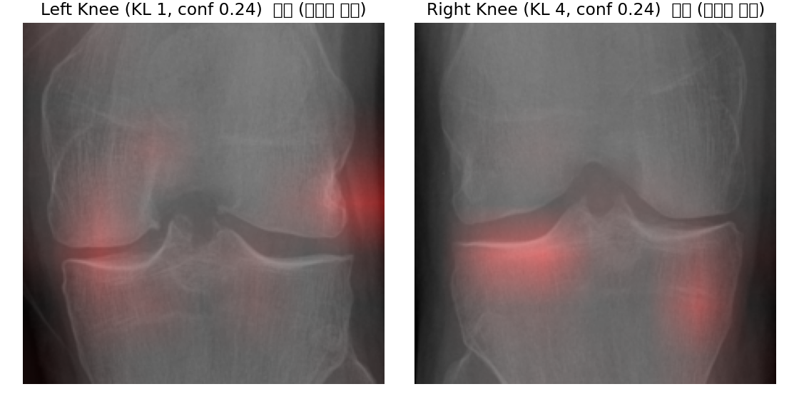

# 🦵 Knee OA Classifier

**무릎 X-ray로 퇴행성 관절염 단계(Kellgren–Lawrence 0~4등급)를 분류하는 AI 보조 시스템**


---

## 📘 개요

무릎 관절염 등급 판정은 X-ray를 보고 관절 간격이 얼마나 좁아졌는지, 뼈가 어떻게 변했는지를 사람이 판단합니다. 이 프로젝트는 그 판정을 돕기 위해 **ResNet50으로 등급을 분류**하고, **Grad-CAM으로 모델이 어느 부위를 근거로 판단했는지 시각화**합니다. Gradio로 이미지를 올리면 결과를 바로 볼 수 있는 화면도 만들었습니다.

---

## 📊 결과

테스트 이미지 **3,052장** 기준입니다. ([평가 보고서](outputs/evaluation/fine_tune_report.txt))

| 지표 | 값 | 의미 |
|---|---|---|
| Accuracy | **0.722** | 전체 중 정확히 맞힌 비율 |
| Macro-F1 | **0.735** | 등급별 성능을 고르게 평균한 값 |
| QWK | **0.847** | 등급 간 거리를 반영한 일치도. 0~4처럼 순서가 있는 등급에서 주로 쓰는 지표 |

**등급별 F1**

| KL 0 | KL 1 | KL 2 | KL 3 | KL 4 |
|---|---|---|---|---|
| 0.81 | **0.43** | 0.70 | 0.84 | 0.89 |

**분석:** KL 1(의심 단계)이 가장 어렵습니다. 혼동 행렬을 보면 KL 1의 상당수가 KL 0이나 KL 2로 분류됐습니다. KL 1은 정상과 초기 변화의 경계라 사람 판독에서도 의견이 갈리는 구간입니다. 반대로 변화가 뚜렷한 KL 3, KL 4는 F1 0.84 이상으로 안정적입니다.

---

## 🔍 Grad-CAM 시각화

모델이 판단할 때 주목한 부위를 색으로 표시합니다. 붉을수록 판단에 크게 영향을 준 부위입니다.

<p align="center">
  
  
</p>

---

## 🧠 모델 · 학습 설정

| 항목 | 설정 |
|---|---|
| 모델 | ResNet50, 출력 5개 등급, dropout 0.2 |
| 입력 크기 | 512 × 512 |
| 최적화 | AdamW, 학습률 3e-4, weight decay 1e-4 |
| 스케줄러 | Cosine Annealing |
| 조기 종료 기준 | 검증 QWK, 5 epoch 동안 개선 없으면 중단 |
| 기타 | Mixed Precision(AMP), seed 42 고정 |

설정 파일: [`src/config/train_resnet50.yaml`](src/config/train_resnet50.yaml)

---

## 👥 팀 구성과 역할

| 이름 | 역할 | 주요 작업 |
|---|---|---|
| **성명규** | 환경 관리 · 모델 | 저장소 구조 설계, Git 협업 규칙 운영, ResNet50 구현 |
| 박경빈 | 데이터 전처리 | X-ray 정제, 증강, 클래스 불균형 보정 |
| 강수아 | 웹 UI | Gradio, Hugging Face UI 제작 |
| 장미 | 시스템 테스트 | 통합 검증, 오류 분석 |
| 최재하 | 시각화 · 해석 | Grad-CAM, 결과 분석 |

---

## 📂 폴더 구조

```
knee-oa-classifier/
├── src/
│   ├── config/      # 학습 · 추론 설정 (yaml)
│   ├── data/        # 데이터셋 로더, 전처리
│   ├── models/      # ResNet50 정의
│   ├── train/       # 학습 루프, 지표
│   ├── eval/        # 평가
│   ├── explain/     # Grad-CAM
│   ├── inference/   # 추론 파이프라인
│   └── ui/          # Gradio 화면
├── scripts/         # 데이터 재구성, 단일 이미지 예측, Grad-CAM 일괄 생성 등
├── deploy_hf/       # Hugging Face 배포용 앱
├── outputs/         # 학습 로그, 평가 보고서, 시각화 결과
└── data/            # (아래 '데이터' 참고)
```

---

## 🗂️ 데이터

- **출처:** Chen, P. (2018). *Knee Osteoarthritis Severity Grading Dataset* (Version 1). Mendeley Data. https://doi.org/10.17632/56rmx5bjcr.1
- **원 데이터:** Osteoarthritis Initiative (OAI)
- **라이선스:** [CC BY 4.0](https://creativecommons.org/licenses/by/4.0/)
- **원본 분할:** 학습 5,778장 · 검증 826장 · 테스트 1,656장 · 자동 검출 테스트 1,526장 (`data/raw/archive2/`)
- 프로젝트에서는 환자 · 좌우 무릎 단위로 다시 정리해 사용했습니다 (`scripts/restructure_*.py`). 최종 평가는 테스트 3,052장 기준입니다.

---

## ▶️ 실행 방법

```bash
git clone https://github.com/mdkk0220/knee-oa-classifier.git
cd knee-oa-classifier
python -m venv .venv
source .venv/bin/activate        # Windows: .\.venv\Scripts\Activate.ps1
pip install -r requirements.txt
```

**데모 화면 실행** (학습된 모델 포함)
```bash
cd deploy_hf
pip install -r requirements.txt
python app.py
```

**이미지 한 장 예측**
```bash
python scripts/predict_single_knee.py \
  --img 경로/무릎사진.png \
  --weights outputs/resnet50_finetune_combined/model_best.pth
```

---

## ⚠️ 한계와 주의

- 이 시스템은 **판독 보조용**이며 의료 진단을 대신하지 않습니다.
- KL 1 등급 성능(F1 0.43)이 낮아 초기 단계 판별에는 한계가 있습니다.
- 하나의 공개 데이터셋으로만 학습해, 다른 병원 · 장비의 X-ray에서는 성능이 달라질 수 있습니다.

---

<details>
<summary>🤝 팀 협업 규칙 (팀원용)</summary>

```bash
git pull origin main                          # 최신 코드 받기
git checkout -b feature/<이름>-<작업명>        # 작업 브랜치 만들기
git add .
git commit -m "feat: <작업 설명>"
git push origin feature/<이름>-<작업명>
```

GitHub에서 Pull Request를 만들고(base: `main`), 리뷰 후 성명규가 merge를 승인합니다.
커밋 전에 `pre-commit install`로 자동 검사를 켜 두세요.

</details>

---

## 📄 License

코드: MIT License. 데이터: CC BY 4.0, 원저작자 Pingjun Chen (위 '데이터' 항목 참고).
