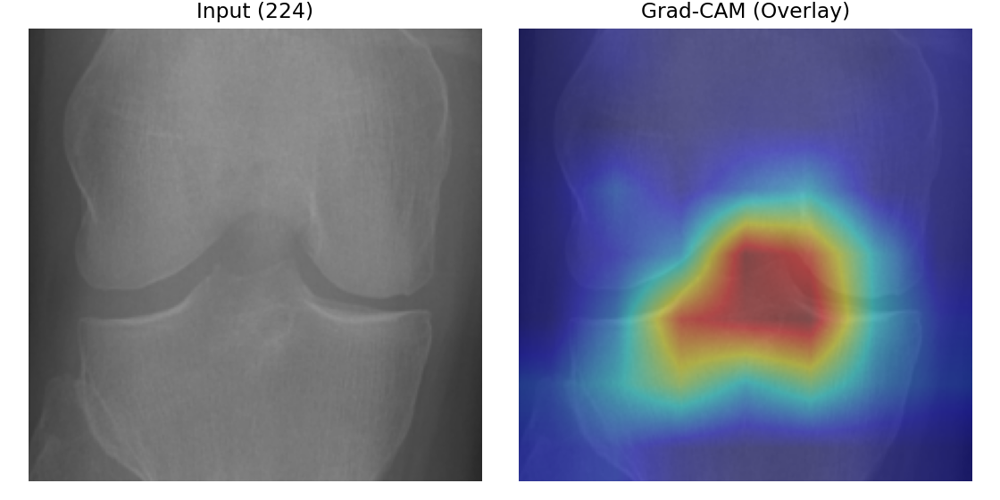
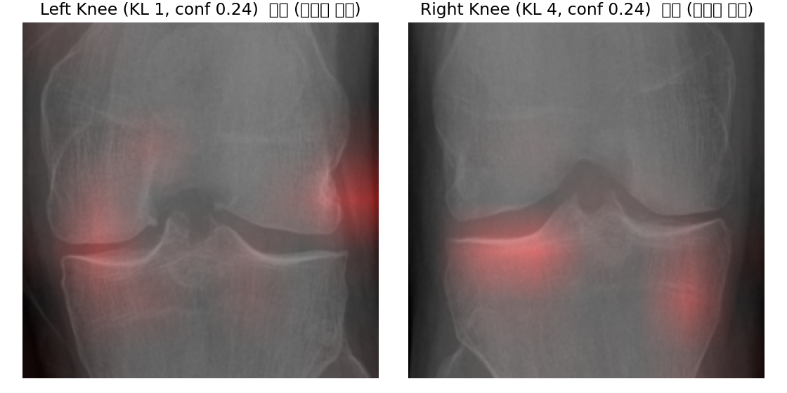

# 결과 · Grad-CAM · 모델 설정

## 📘 개요

무릎 관절염 등급 판정은 X-ray를 보고 관절 간격이 얼마나 좁아졌는지, 뼈가 어떻게 변했는지를 사람이 판단합니다. 이 프로젝트는 그 판정을 돕기 위해 **ResNet50으로 등급을 분류**하고, **Grad-CAM으로 모델이 어느 부위를 근거로 판단했는지 시각화**합니다. Gradio로 이미지를 올리면 결과를 바로 볼 수 있는 화면도 만들었습니다.

## 📊 결과

테스트 이미지 **3,052장** 기준입니다. ([평가 보고서](../outputs/evaluation/fine_tune_report.txt))

| 지표 | 값 | 의미 |
|---|---|---|
| Accuracy | **0.722** | 전체 중 정확히 맞힌 비율 |
| Macro-F1 | **0.735** | 등급별 성능을 고르게 평균한 값 |
| QWK | **0.847** | 등급 간 거리를 반영한 일치도. 0~4처럼 순서가 있는 등급에서 주로 쓰는 지표 |

**등급별 F1**

| KL&nbsp;0 | KL 1 | KL 2 | KL 3 | KL 4 |
|---|---|---|---|---|
| 0.81 | **0.43** | 0.70 | 0.84 | 0.89 |

**분석:** KL 1(의심 단계)이 가장 어렵습니다. 혼동 행렬을 보면 KL 1의 상당수가 KL 0이나 KL 2로 분류됐습니다. KL 1은 정상과 초기 변화의 경계라 사람 판독에서도 의견이 갈리는 구간입니다. 반대로 변화가 뚜렷한 KL 3, KL 4는 F1 0.84 이상으로 안정적입니다.

## 🔍 Grad-CAM 시각화

모델이 판단할 때 주목한 부위를 색으로 표시합니다. 붉을수록 판단에 크게 영향을 준 부위입니다.

  
  

## 🧠 모델 · 학습 설정

| 항목 | 설정 |
|---|---|
| 모델 | ResNet50, 출력 5개 등급, dropout 0.2 |
| 입력&nbsp;크기 | 512 × 512 |
| 최적화 | AdamW, 학습률 3e-4, weight decay 1e-4 |
| 스케줄러 | Cosine Annealing |
| 조기&nbsp;종료&nbsp;기준 | 검증 QWK, 5 epoch 동안 개선 없으면 중단 |
| 기타 | Mixed Precision(AMP), seed 42 고정 |

설정 파일: [`src/config/train_resnet50.yaml`](../src/config/train_resnet50.yaml)

## ⚠️ 한계와 주의

- 이 시스템은 **판독 보조용**이며 의료 진단을 대신하지 않습니다.
- KL 1 등급 성능(F1 0.43)이 낮아 초기 단계 판별에는 한계가 있습니다.
- 하나의 공개 데이터셋으로만 학습해, 다른 병원 · 장비의 X-ray에서는 성능이 달라질 수 있습니다.

[← 처음으로](../README.md)
